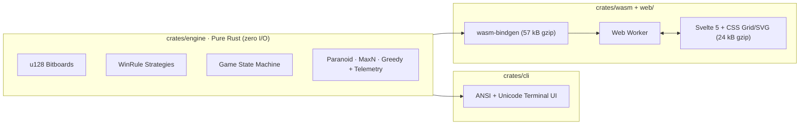

# Tic-Tac-Twist Neo

**A blazingly fast, zero-backend 3-player strategy game powered by a Rust `u128` bitboard engine — compiled to WebAssembly for the browser and native machine code for the terminal.**

[](https://syntaxval.github.io/tic-tac-twist-neo/)
[](crates/engine)
[](crates/wasm)
[](web)
[](LICENSE)

---

### [Launch the Live Web App →](https://syntaxval.github.io/tic-tac-twist-neo/)

Play directly in your desktop or mobile browser with **zero server round-trips** — the Rust AI runs locally inside a Web Worker while keeping the UI locked at 60–120 fps.

---

## Why This Exists

Tic-Tac-Twist takes classic Tic-Tac-Toe and raises the stakes: **3 players**, scalable boards from **3×3 up to 10×10**, configurable **K-in-a-row** and **Four Corners** win rules, and a real-time multi-player AI.

Most implementations either choke on a 10×10 search space or duplicate game logic across backend and frontend. **Tic-Tac-Twist Neo** solves both with a single pure-Rust domain engine compiled to two thin targets:
- **Browser / Mobile (WASM + Web Worker):** Near-native AI search throughput with a ~24 kB Svelte 5 UI and live search telemetry.
- **Terminal (Native CLI):** Direct ANSI + Unicode terminal experience sharing 100% of the exact same rules and AI.

---

## Engineering Highlights

| Capability | Design |
| :--- | :--- |
| **Board Representation** | **`u128` bitboards** (1 bit per cell up to 10×10 = 100 bits) — single-cycle win checks, $O(1)$ coordinate math, and zero-allocation make/unmake in search. |
| **3-Player Game AI** | Tactical 1-move win/block layer + pluggable **Paranoid Alpha-Beta** (iterative deepening, time budget, Zobrist hashing, 65k Transposition Table), **MaxN** (multi-player utility vectors), and **Greedy** (1-ply baseline). |
| **Live Telemetry HUD** | Every AI turn emits structured search metrics: algorithm, depth reached, nodes evaluated, TT hit count, elapsed ms, and nodes/sec. |
| **Composable Rules** | `WinRule` strategy trait (`LinesRule` + `FourCornersRule`) — new win conditions plug in cleanly with zero global config coupling. |
| **Accessible, Lean UI** | Zero-dependency CSS Grid + SVG in **Svelte 5** (runes), automatic light/dark `color-scheme`, roving-tabindex arrow-key spatial navigation, and customizable `<select>` controls. |

---

## Architecture



```text
tic-tac-twist-neo/
├── crates/
│   ├── engine/          # Pure Rust core: bitboards, rules, state machine, 3-player AI
│   ├── cli/             # Native terminal binary
│   └── wasm/            # Thin wasm-bindgen bridge
├── web/                 # Svelte 5 + TypeScript + Vite static web app (Web Worker)
├── docs/adr/            # Architecture Decision Records
└── .github/workflows/   # Automated tests, WASM build, and GitHub Pages deployment
```

---

## Quickstart

### Play Online
Open **[syntaxval.github.io/tic-tac-twist-neo](https://syntaxval.github.io/tic-tac-twist-neo/)** — no install required.

### Play in the Terminal (Native CLI)
```sh
cargo run --release -p tic-tac-twist-cli -- --size 5 --win-length 4 --ai paranoid
```
Run with `--help` to see all options (`--size`, `--win-length`, `--four-corners`, `--ai paranoid|maxn|greedy`, `--time-ms`).

### Run the Web App Locally
Requires Rust (`wasm32-unknown-unknown` target), `wasm-pack`, Node.js 22+, and `pnpm`:
```sh
wasm-pack build crates/wasm --target web --out-dir ../../web/src/wasm
pnpm --dir web install
pnpm --dir web dev
```

### Run Tests & Lints
```sh
cargo test --workspace
cargo clippy --workspace --all-targets -- -D warnings
pnpm --dir web check
pnpm --dir web build
```

---

## Architecture Decision Records

Every major trade-off is documented in `docs/adr/`:
- [ADR 001: `u128` Bitboards for 3×3–10×10 Boards](docs/adr/001-u128-bitboards.md)
- [ADR 002: 3-Player AI — Paranoid Alpha-Beta vs. MaxN](docs/adr/002-three-player-ai-paranoid-vs-maxn.md)
- [ADR 003: Single Rust Engine → WASM Web Worker + Native CLI](docs/adr/003-rust-wasm-web-worker.md)
- [ADR 004: CSS Grid + SVG (Svelte 5) Over WebGL](docs/adr/004-dom-svg-over-webgl.md)

## License

Released under the [Apache License, Version 2.0](LICENSE).
